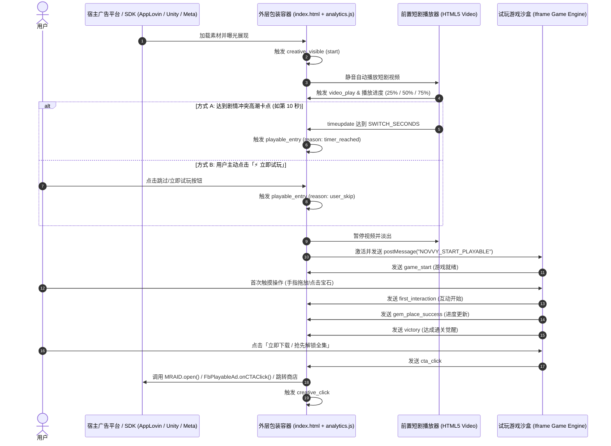

# Novvy 视频转试玩 (Video-to-Playable) 广告素材技术规范与事件埋点手册

> **版本**：v2.0 (生产环境标准)  
> **面向对象**：广告买量团队、投放运营、数据分析师 (BI)、素材前端与引擎开发。  
> **适用范围**：Novvy Landing Page 自动生产平台导出的短剧广告落地页 ZIP 压缩包、可玩广告 (Playable) 及渠道 SDK。

---

## 目录
- [一、素材包结构与运行架构](#一素材包结构与运行架构)
- [二、全漏斗事件埋点清单 (Event Reference)](#二全漏斗事件埋点清单-event-reference)
  - [1. 曝光与生命周期事件](#1-曝光与生命周期事件)
  - [2. 前置短剧视频阶段事件](#2-前置短剧视频阶段事件)
  - [3. 视频切入试玩过渡事件 (核心卡点)](#3-视频切入试玩过渡事件-核心卡点)
  - [4. 试玩互动游戏阶段事件](#4-试玩互动游戏阶段事件)
  - [5. 转化与点击跳转事件 (CTA)](#5-转化与点击跳转事件-cta)
  - [6. 异常与错误监控事件](#6-异常与错误监控事件)
- [三、跨层通信与各主流渠道原生唤起协议](#三跨层通信与各主流渠道原生唤起协议)
- [四、短剧画风视觉统一引擎 (Visual Synthesizer)](#四短剧画风视觉统一引擎-visual-synthesizer)
- [五、数据指标与 BI 漏斗分析模型](#五数据指标与-bi-漏斗分析模型)

---

## 一、素材包结构与运行架构

通过服务导出的 ZIP 压缩包（如 `my_daddy_drowns_gods_playable.zip`）采用**双层解耦沙盒架构**：

```text
playable_ad.zip
├── index.html              # [核心入口] 承载视频播放、倒计时无缝切入与全局事件聚合的主控宿主
├── tail-ad-video.mp4       # [前置视频] 高清短剧精彩片段/冲突起承视频 (H.264 + AAC)
├── app-icon.png            # [推广图标] 应用高清图标 (512x512 PNG)
├── analytics.js            # [数据核心] Novvy 官方事件采集与宿主 SDK 桥接库 (SHA-256 完整性校验)
└── manifest.json           # [元数据] 记录短剧ID、高潮切入秒数、插槽素材哈希
```

### 运行时双层沙盒流转模型



---

## 二、全漏斗事件埋点清单 (Event Reference)

### 1. 曝光与生命周期事件

| 事件名称 | 触发时机 | 携带参数 (Payload) | 业务/BI 价值 |
| :--- | :--- | :--- | :--- |
| **`creative_visible`** | 广告页面进入屏幕可视区域并开始呈现 | `{"lifecycle": "start" \| "resume"}` | 统计**有效展示数 (Impression)**，计费起点。 |
| **`creative_hidden`** | 用户切出应用、锁屏或滑出屏幕可视区 | `{"active_duration_ms": 12500}` | 统计用户在广告上的**净停留时长 (Active Dwell Time)**。 |

---

### 2. 前置短剧视频阶段事件

所有媒体事件由 `analytics.js` 中的 `registerMedia` 自动捕获与防抖，无需手动编写监听。

| 事件名称 | 触发时机 | 携带参数 (Payload) | 业务/BI 价值 |
| :--- | :--- | :--- | :--- |
| **`video_play`** / **`media_play`** | 短剧前置视频首帧起播 | `{"media": "tail_ad_video", "muted": true}` | 视频起播率，分析冷启动性能。 |
| **`media_progress`** (25%) | 播放进度达到 25% | `{"media": "tail_ad_video", "percent": 25}` | 视频播放漏斗：前 3 秒吸引力。 |
| **`media_progress`** (50%) | 播放进度达到 50% | `{"media": "tail_ad_video", "percent": 50}` | 视频中点完播率。 |
| **`media_progress`** (75%) | 播放进度达到 75% | `{"media": "tail_ad_video", "percent": 75}` | 冲突发酵度，接近互动切入点。 |
| **`media_complete`** | 视频自然播放完完整片段 | `{"media": "tail_ad_video", "duration_ms": 15000}` | 视频完整完播数。 |
| **`video_mute`** | 用户点击静音 | `{"target": "sound_button", "action": "mute"}` | 声音交互偏好。 |
| **`video_unmute`** | 用户开启声音 | `{"target": "sound_button", "action": "unmute"}` | 强烈的沉浸式收听意愿。 |

---

### 3. 视频切入试玩过渡事件 (核心卡点)

| 事件名称 | 触发时机 | 携带参数 (Payload) | 业务/BI 价值 |
| :--- | :--- | :--- | :--- |
| **`playable_entry`** | **从短剧视频阶段无缝切换进入互动试玩界面** | `{"reason": "timer_reached" \| "user_skip" \| "video_ended", "switch_seconds": 10}` | **试玩切入转化率**。<br>对比不同切入原因 (`timer_reached` 剧情卡点 vs `user_skip` 主动进入) 的后续 CTR。 |

---

### 4. 试玩互动游戏阶段事件

内层游戏引擎（Cocos / Canvas）在用户交互时向上抛出标准化消息：

| 事件名称 | 触发时机 | 携带参数 (Payload) | 业务/BI 价值 |
| :--- | :--- | :--- | :--- |
| **`game_start`** | 互动试玩游戏引擎加载完成并就绪 | `{"template": "colorever_gem_array_v1"}` | 衡量试玩渲染速度与就绪率。 |
| **`first_interaction`** | **用户在试玩区进行首次有效触摸/点击/拖放** | `{"trigger": "canvas_touch"}` | **核心试玩互动率 (Engagement Rate = 首次互动 / 试玩切入)**。 |
| **`gem_place_success`** / **`puzzle_placement`** | 用户成功放置/消除一颗宝石或拼图碎片 | `{"progress": 25, "step": 1}` | 衡量互动深度与关卡参与流失。 |
| **`victory`** | 达成指定通关目标（解开封印、主角觉醒）弹出结算卡 | `{"successCount": 4}` | **试玩通关率 (Completion Rate)**。 |

---

### 5. 转化与点击跳转事件 (CTA)

| 事件名称 | 触发时机 | 携带参数 (Payload) | 业务/BI 价值 |
| :--- | :--- | :--- | :--- |
| **`cta_click`** / **`creative_click`** | **用户点击游戏内下载、通关卡牌按钮或顶部 CTA** | `{"target": "primary_cta", "action": "click", "scene": "end_card"}` | **最终点击率 (CTR)**。<br>计费事件，自动调用底层 MRAID / Meta 商店跳转协议。 |

---

### 6. 异常与错误监控事件

| 事件名称 | 触发时机 | 携带参数 (Payload) | 业务/BI 价值 |
| :--- | :--- | :--- | :--- |
| **`media_error`** | 视频解码错误、格式不兼容或播放失败 | `{"media": "tail_ad_video", "code": 3}` | 终端兼容性与视频源健康度监控。 |
| **`creative_error`** | 页面或游戏引擎中未捕获的 JavaScript 异常 | `{"message": "...", "source": "...", "line": 120}` | 灰度放量与排查特定设备白屏。 |
| **`creative_promise_rejection`**| 异步网络或解码 Promise 抛出未捕获 Reject | `{"reason": "..."}` | 弱网与解析异常捕获。 |

---

## 三、跨层通信与各主流渠道原生唤起协议

### 1. 内层 Playable 发送事件规范
如果开发自研互动模板，可通过原生标准 `postMessage` 向外层汇报事件：
```javascript
// 触发通用互动事件
if (window.parent && window.parent !== window) {
  window.parent.postMessage({
    type: 'novvy_playable_event',
    event: 'gem_place_success',
    detail: { progress: 50, step: 2 }
  }, '*');
}

// 触发转化点击
if (window.parent && window.parent !== window) {
  window.parent.postMessage({
    type: 'novvy_playable_event',
    event: 'cta_click',
    detail: { trigger: 'modal_cta' }
  }, '*');
}
```

### 2. 全渠道应用商店唤起兼容矩阵
当触发 `cta_click` 时，外层包装脚本严格按如下优先级自动适配各广告平台：

```javascript
function handleAdClick() {
  trackEvent('cta_click');

  // 1. MRAID 协议 (AppLovin MAX, Unity Ads, Mintegral, Liftoff)
  if (typeof window.mraid !== 'undefined' && typeof window.mraid.open === 'function') {
    window.mraid.open(STORE_URL);
    return;
  }
  // 2. Meta Playable 协议 (Facebook / Instagram Ads)
  if (typeof window.FbPlayableAd !== 'undefined' && typeof window.FbPlayableAd.onCTAClick === 'function') {
    window.FbPlayableAd.onCTAClick();
    return;
  }
  // 3. ironSource dapi 协议
  if (typeof window.dapi !== 'undefined' && typeof window.dapi.openStoreUrl === 'function') {
    window.dapi.openStoreUrl();
    return;
  }
  // 4. Novvy SDK 原生客户端协议
  if (window.novvy && typeof window.novvy.click === 'function') {
    window.novvy.click('primary_cta', 'click');
  }
  // 5. 浏览器 Web / H5 兜底
  if (STORE_URL && STORE_URL !== '#') {
    window.open(STORE_URL, '_blank');
  }
}
```

---

## 四、短剧画风视觉统一引擎 (Visual Synthesizer)

为了防止 AI 提取或手动上传的素材出现**“东拼西凑、画风突兀、与前置短剧脱节”**的问题，所有素材打包前均通过统一画风合成器重构：

| 素材插槽 | 原始状态 | 统一后的电影级效果 |
| :--- | :--- | :--- |
| **`bg_image`** (背景图) | 任意清晰度剧照 / 截图 | **9:16 景深虚化舞台**：14px 电影级高斯虚化 + 径向暗角 (Vignette) + 顶部 HUD 遮光渐变 + 底部操作区压暗，保证不抢前景焦点。 |
| **`hero_avatar`** (主角头像) | 普通人物正脸照 | **圣光金环阵营卡牌**：居中圆形面部聚焦 + 金黄与天青双层神力光晕 + 金属描边外框 + 底部「我方主角」徽章 + 浮空呼吸阴影。 |
| **`rival_avatar`** (反派头像) | 敌对角色照片 | **煞气红环敌对卡牌**：居中圆形面部聚焦 + 猩红与暗紫煞气双层光晕 + 压迫感外框 + 底部「敌方伪神」徽章。 |
| **`puzzle_pattern`** (法宝/道具) | 带有背景的方块截图 | **透明晶莹法宝神印**：自动进行菱形晶面羽化抠像，剥离杂乱背景，转换为带有流光金边的通透神印。 |
| **顶部 HUD 栏** | 原始系统文字 | **深色毛玻璃 HUD**：高斯模糊底板 (`backdrop-filter: blur(12px)`) + 流金渐变文字描边，与短剧画质无缝呼应。 |

---

## 五、数据指标与 BI 漏斗分析模型

通过本素材包上报的事件，买量与运营团队可直接建立如下核心漏斗：

```text
[有效展现] creative_visible (100%)
   │
   ├─► [视频起播] video_play (98%)
   │     │
   │     ├─► [25% 进度] media_progress (85%)
   │     ├─► [50% 进度] media_progress (72%)
   │     └─► [75% 进度] media_progress (61%)
   │
   ├─► [切入试玩] playable_entry (68%)
   │     │
   │     ├─ 剧情卡点自动切换: reason = 'timer_reached' (55%)
   │     └─ 用户主动点击跳过: reason = 'user_skip' (13%)
   │
   ├─► [首次互动] first_interaction (48%)  ──► 互动率 = 48% / 68% = 70.5%
   │
   ├─► [完成通关] victory (32%)            ──► 通关率 = 32% / 48% = 66.7%
   │
   └─► [最终点击] cta_click (21%)          ──► 落地页 CTR = 21%
```
